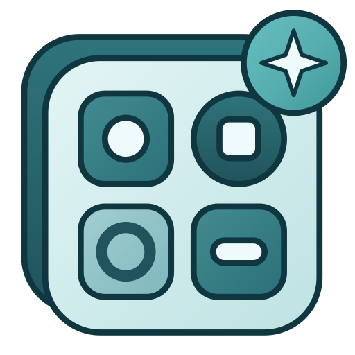

<div align="center">



# Icon Restyle for Moodle

*Give every icon of your Moodle its own look, from one designer, without touching the theme*

[](https://github.com/didactika/moodle-local_iconrestyle/releases)
[](https://moodle.org)
[](https://www.php.net)
[](LICENSE)

[Overview](#overview) • [Technology](#technology) • [Installation](#installation) • [Usage](#usage) • [User manual](#user-manual) • [Configuration](#configuration) • [Command line](#command-line) • [Performance](#performance) • [Troubleshooting](#troubleshooting)

</div>

Icon Restyle (**local_iconrestyle**) changes how Moodle draws its icons without touching the theme or the core. A designer in the site administration lists every icon that can be customised. Choose one, change its colour, shape, spacing, effects or replace it with a file of your own, and the whole site shows it. Customisations are stored per place and delivered to each page as one cached stylesheet, so replaced icons need no JavaScript on the pages of your users and add no database query to a page view once the cache is warm.


## Overview

- **One designer** for every icon: Font Awesome icons, image icons and the boxes of activities, in a searchable and filterable grid that stays fast with thousands of icons.
- **Everything you would expect**: icon and background colour, gradient, shape and corner radius, border and outline, padding and margin on each side, scale, rotation, skew and flips, box and icon shadows, blending, a hover effect, opacity, and the usual colour filters.
- **Your own artwork** (SVG, PNG or WebP) replaces any icon; single-colour files can be recoloured. Every file is sanitised.
- **Theme colours**: pick any colour the active theme declares, such as `--bs-primary`, and the icon follows the theme.
- **Places**: a look can apply to the whole site, a category, a course or an activity, to some kinds of page, to some parts of a page and, when your site has colour modes, to one of them. The most specific look wins.
- **Light and dark**: the designer follows the colour modes of Moodle and the colours of the theme.
- **Work in bulk**: filter by type, status, component, purpose, what an icon customises, place and colour mode; choose many icons at once; copy a look to many icons; copy one colour mode to another.
- **Export and import** between sites, of everything or only the icons you choose, with a review step before anything changes.
- **Safe and fast**: every value is typed and range-checked, a stylesheet is compiled once however many visitors ask for it, and limits stop a site from growing the stylesheets past what a browser handles well.

## Technology

The designer is a React 19 application written in TypeScript, mounted by Moodle's own `core/react_autoinit` from a component that implements `core\output\react_component_renderable`. The source is in `js/esm/src` and the build that Moodle serves is committed in `js/esm/build`; rebuild it with `npx grunt esm` from the root of Moodle. The server side (rules, limits, delivery, export and import) is the same as in the maintenance line for Moodle 4.0 to 5.2.

## Installation

**Requirements:** Moodle 5.3, PHP 8.3 or newer and the database requirements of the selected Moodle release. This distribution's release is **5.3.0**. Moodle 4.0 to 5.2 have a maintenance line of their own (`MOODLE_400_STABLE`) with the same features and an interface written in AMD and Mustache.

**From a release:** download the matching release ZIP, open **Site administration → Plugins → Install plugins**, upload the package and follow the prompts.

**From Git:**

```bash
cd /path/to/moodle
git clone --branch main https://github.com/didactika/moodle-local_iconrestyle.git public/local/iconrestyle
php admin/cli/upgrade.php --non-interactive
```

The plugin directory in Moodle 5.3 is `public/local/iconrestyle`.

## Usage

1. Open **Site administration → Plugins → Local plugins → Icon Restyle → Icon designer**. It is also under **Site administration → Appearance → Icon Restyle**.
2. Search the icon, for example `a/setting`, and click its card.
3. Change what you want in the panel. The preview shows it at once and it is saved on its own; there is no save button.
4. To limit the look to a category, a course, an activity, some pages or a colour mode, use the **Places** tab.

Every control is explained, with screenshots, in the [user manual](https://github.com/didactika/moodle-local_iconrestyle/wiki).

## User manual

- **[User manual](https://github.com/didactika/moodle-local_iconrestyle/wiki)**: a wiki with a start page that says what to read first, then getting started, the designer, finding icons, editing, places and colour modes, copying looks, export and import, administration and troubleshooting.
- The screenshots are taken from the real designer by `tests/behat/manual.feature`; run it with `--tags=@iconrestyle_manual` to refresh them.

## Configuration

The plugin has a section of its own, **Site administration → Plugins → Local plugins → Icon Restyle**, with the **Icon designer** and the **Settings**.

| Setting | Default | Meaning |
|---|---|---|
| `local_iconrestyle/enabled` | Enabled | When disabled, no customised icon stylesheet is added to any page. Saved customisations are kept. |
| `local_iconrestyle/maxrulespercontext` | 500 | Most customisations that one site, category or course may hold. New rules beyond the limit are refused. |
| `local_iconrestyle/maxsheetkb` | 256 | Largest compiled stylesheet, in KB, of the site, one category or one course. A change that would make it bigger is refused whole. |
| `local_iconrestyle/maxcontextswithrules` | 500 | Most categories and courses, besides the whole site, that may have customisations of their own. Each is a different stylesheet that browsers download once. |
| `local_iconrestyle/maxeffectcost` | 2000 | What the effects of the rules of one context may add up to. Blur, shadows and colour filters make the browser paint an icon in an extra step, so each rule adds a cost for them and one rule may cost at most 20. |
| `local_iconrestyle/copygroups` | colours, shape, spacing, rotation and flips, effects | The parts of a look that are chosen when someone starts copying the look of an icon to others. The replacement icon is off unless it is turned on here. |
| `local_iconrestyle/copyoverwrite` | off | Whether copying looks from one colour mode to another replaces the looks that already exist. |
| `local_iconrestyle/importmode` | merge | Whether an import adds to what the site has (`merge`) or replaces it (`replace`) when it opens. |
| `local_iconrestyle/importchoose` | all | Which icons of a package are chosen when an import opens: `all`, `new` or `none`. |

The last four only decide what the designer starts from. Each person can change them every time they use a choice, and what they change is not kept.

To disable the plugin without the administration interface, set `$CFG->local_iconrestyle_disabled = true;` in `config.php`.

### Permissions

| Capability | Context | Default |
|---|---|---|
| `local/iconrestyle:manage` | System | Manager |
| `local/iconrestyle:exchange` | System | Manager |

Capabilities that change what every page renders carry the XSS risk flag. Icons are customised in one place, so one capability governs every rule, wherever it applies.

## Command line

| Command | Does |
|---|---|
| `php local/iconrestyle/cli/warm.php` | Compiles the stylesheets that are not in the cache. Purging the caches or upgrading Moodle empties them; a scheduled task does the same every ten minutes, so run this to have them at once. |
| `php local/iconrestyle/cli/export.php --file=FILE [--slots=LIST]` | Writes every customisation to a file, however many there are, or only those of the icons in the comma separated list. |
| `php local/iconrestyle/cli/import.php --file=FILE [--mode=merge\|replace] [--dry-run]` | Imports a file, reading it one line at a time. `--dry-run` says what would be done and changes nothing. |

## Performance

A page whose stylesheets are cached adds no database query and about twenty microseconds of work, however many courses, categories and rules the site has: the work depends on the contexts on the path of the page, not on the size of the site. What keeps a very large site fast is that every stylesheet is compiled once however many visitors ask for it at the same moment, each context keeps only its newest stylesheet in the cache, a rule limited to many pages and regions writes its selectors as lists, and the settings above stop the stylesheets, their number and the cost of the effects from growing past what a browser handles well.

The benchmarks are part of the test suite, with budgets that fail the build when they are exceeded (`tests/performance`). The measurements on a large site are in the [performance report](https://github.com/didactika/moodle-local_iconrestyle/wiki/Performance-report).

## Troubleshooting

| Problem | Check |
|---|---|
| A change does not show on a page | Reload with Ctrl+F5 and check that **Enabled** is on in the settings. |
| *Could not save* | A limit of the site (rules, stylesheet size, effect cost) is the usual cause; the message says which. |
| Two icons change together | They share one glyph in Moodle and cannot be styled apart; the panel says so. |
| An import leaves rules out | The report lists why: a place or an icon that this site does not have, or refused artwork. |

More in the [troubleshooting chapter](https://github.com/didactika/moodle-local_iconrestyle/wiki/Troubleshooting).

## Development

The styles are written as nested SCSS (`styles.scss` and the partials in `scss/`) and compiled into the `styles.css` that is distributed. After changing them, run `node tools/build-styles.mjs /path/to/moodle` with the root of a Moodle checkout (it uses the Sass of that checkout and checks the result with the stylelint of Moodle). The pipeline runs the same command with `--check` and fails when `styles.css` is not what the sources produce.

## Getting help

Open an [issue](https://github.com/didactika/moodle-local_iconrestyle/issues) with your Moodle and PHP versions, the theme in use and what you expected.
