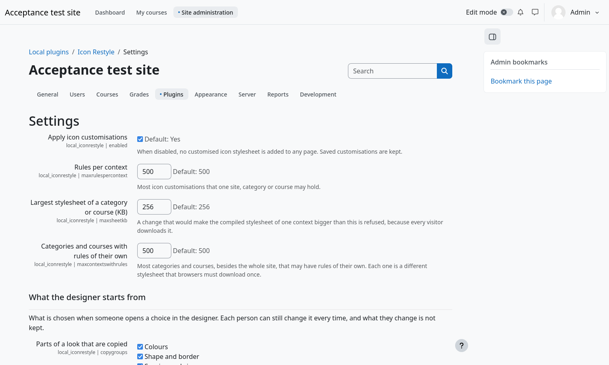

# Administration

## Where things are

**Site administration → Plugins → Local plugins → Icon Restyle** holds the **Icon designer** and the **Settings**. The designer
is also under **Site administration → Appearance → Icon Restyle**.

## Permissions

| Capability | Default | Allows |
|---|---|---|
| `local/iconrestyle:manage` | Manager | Use the designer. |
| `local/iconrestyle:exchange` | Manager | Export and import customisations. |

One capability governs every rule, wherever it applies. These capabilities change what every page renders, so they carry the
XSS risk flag: give them only to people you trust with the look of the whole site.

## Settings

| Setting | Default | Meaning |
|---|---|---|
| **Apply icon customisations** | On | When off, no stylesheet of Icon Restyle is added to any page. Saved customisations are kept. |
| **Rules per context** | 500 | Most customisations that one site, category or course may hold. Beyond that, new rules are refused. |
| **Largest stylesheet of a category or course (KB)** | 256 | A change that would make the stylesheet of a place bigger is refused whole, because every visitor downloads it. |
| **Categories and courses with rules of their own** | 500 | Categories and courses, besides the whole site, that may have customisations of their own. Each is a different stylesheet. |
| **Effect budget of a category or course** | 2000 | Blur, shadows and colour filters make the browser paint an icon in an extra step; each rule adds a cost and one rule may cost at most 20. |
| **What the designer starts from** | | |
| **Parts of a look that are copied** | All but the replacement icon | Chosen when someone starts copying a look to other icons. |
| **Replace looks that already exist when copying between modes** | Off | |
| **How an import starts** | Add to what the site has | Or *Replace what the site has*. |
| **Icons chosen when importing** | All the icons of the package | Or *Only the icons that are new to the site*, or *None*. |

The last four only decide what the designer starts from. Each person can change them every time, and what they change is not kept.

To switch the plugin off without the administration interface, add `$CFG->local_iconrestyle_disabled = true;` to `config.php`.

## Command line

| Command | Does |
|---|---|
| `php local/iconrestyle/cli/warm.php` | Prepares the stylesheets that are not in the cache. Purging the caches or upgrading empties them; a scheduled task does the same every ten minutes. |
| `php local/iconrestyle/cli/export.php --file=FILE [--slots=LIST]` | Writes every customisation to a file, however many there are, or only the icons in the list. |
| `php local/iconrestyle/cli/import.php --file=FILE [--mode=merge\|replace] [--dry-run]` | Imports a file one line at a time. `--dry-run` says what would be done and changes nothing. |

From Moodle 5.1 the plugin directory is `public/local/iconrestyle`.

## How it stays fast

- A page whose stylesheets are cached adds no database query and about twenty microseconds of work, however large the site is.
- Every stylesheet is compiled once, however many visitors ask for it at the same moment, and it is delivered as one cached file.
- Each place keeps only its newest stylesheet in the cache, and browsers download each different stylesheet once.
- A rule limited to many pages and regions writes its selectors as lists, so it stays small.
- The limits above stop a site from growing the stylesheets, the number of stylesheets or the cost of effects past what a
  browser handles well.

The measurements are in the performance report of the repository.

## Privacy

The plugin stores no personal data, only who last changed a rule and who added a file. It exports that for a data request and,
when a user is erased, keeps the customisation and forgets who made it.
