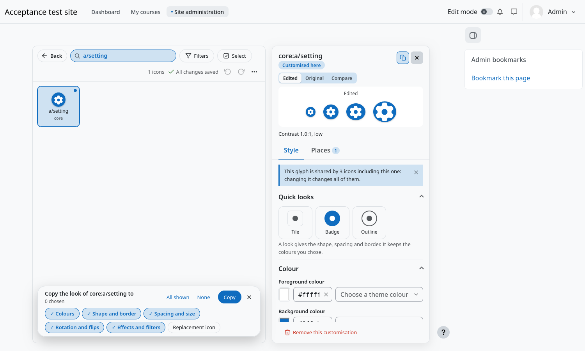

# Copying looks

Two tools save you from setting the same look many times. Both work in the grid itself, so you can search and filter first to
find the icons you want to reach.

## Copy the look of one icon to other icons

1. Open the icon whose look you want to copy and press the **two sheets** button in the header of the panel (*Copy this look
   to other icons*).
2. A bar floats over the grid: **Copy the look of core:a/setting to…**. Search or filter, then click the cards that should
   receive the look. Shift+click chooses a run, **All shown** chooses everything the filters leave.
3. Choose **what to copy** with the chips: **Colours**, **Shape and border**, **Spacing and size**, **Rotation and flips**,
   **Effects and filters** and **Replacement icon**. The replacement icon is off until you turn it on.
4. Press **Copy**. The look goes to the same place, colour mode, pages and regions as the one you are editing, and **one Undo
   takes the whole copy back**.

An icon of an image kind that gets a colour fetches its own file so it can be coloured; this happens by itself.

## Copy one colour mode to another

When your site has colour modes, choose icons with **Select** and use the **colour modes** button (a circle with one half filled) in the bar:

1. Choose the icons (it is usual to filter *Status → Customised* and press **All shown**).
2. Press the colour modes button. Choose the mode to copy **from** and the one to copy **to**.
3. Tick **Replace existing** only if the second mode already has looks that you want to overwrite. Otherwise they are left as
   they are.
4. Press **Copy**. A message says how many looks were copied and how many were left because they already existed.

Every look that belongs to the first mode, wherever it applies, is copied to the second mode in the same place. One Undo takes
it all back.

## Start from what the site prefers

The administrator can decide what is chosen when these tools open: which parts of a look are copied, whether copying between
modes replaces what exists, and how an import starts. See [Administration](Administration.md). Whatever the administrator chose,
you can change it every time, and what you change is not kept.
