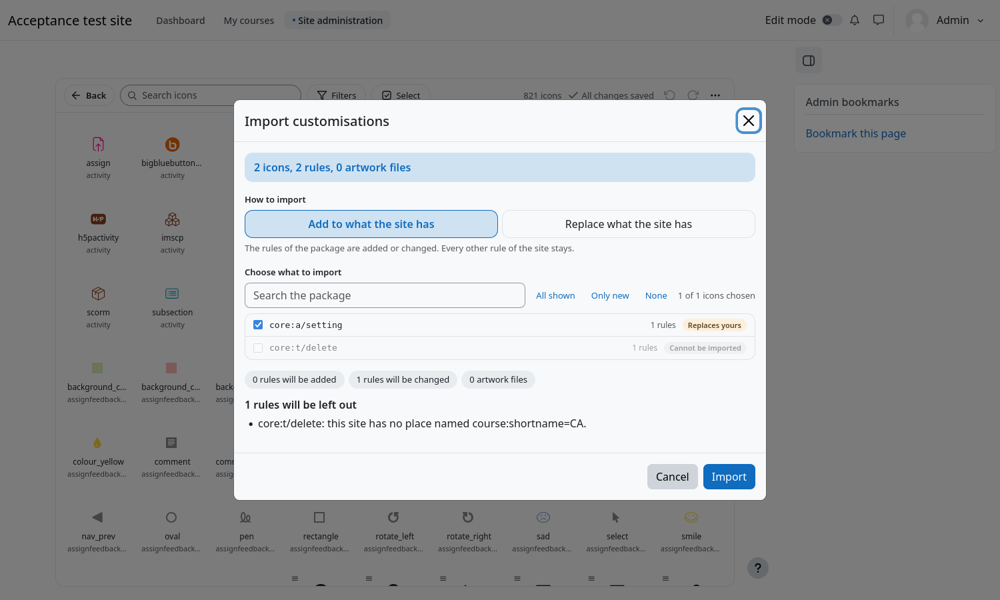

# Export and import

Use a package to give a production site the look you built on a test site, to share a look between campuses, or to keep a
copy. You need the capability `local/iconrestyle:exchange`.

A package is a plain text file with the extension `.iconrestyle`. It names places instead of using database numbers (a
category by its id number, a course by its short name, an activity by its id number), so it travels between sites. It carries
no personal data.

## Export

- **⋯ menu → Export all customisations** exports everything.
- **Select** (in the toolbar) exports only some icons: choose them in the grid, press **Export**. Icons that were never
  customised are dimmed. Only the rules of the chosen icons, and the artwork they use, go in the file.


A message says how many rules were left out and why. A rule is left out when its place cannot be named: an activity without an
id number, for example.

## Import

1. **⋯ menu → Import customisations**, and choose a `.iconrestyle` file (up to 20 MB through the browser).
2. A window reviews the package **before anything changes**:



   - A summary: how many icons, rules and artwork files the package holds.
   - **How to import**: **Add to what the site has** adds the rules of the package and changes the ones that already exist, and
     every other rule stays; **Replace what the site has** makes the site have exactly the rules of the package.
   - **Choose what to import**: every icon of the package with how many rules it has and a badge, *New*, *Replaces yours* or
     *Cannot be imported*. Search the list, and use **All shown**, **Only new** and **None**.
   - A live report of what the button would do for the choice made: rules that would be added, changed or removed, and the
     reasons a rule would be left out.
3. Press **Import**. Only then is anything changed.

With some icons chosen, **Replace** only replaces those icons; the other icons of the site stay as they are. With every icon
chosen it makes the site exactly the package.

## Nothing in a package is trusted

Every rule goes through the same checks as one made in the designer, and every artwork file is cleaned again as if it had
been uploaded. A rule that does not pass is left out and reported, and the rest of the package goes on.

## Very large packages

A package bigger than 20 MB is imported from the command line, which reads the file one line at a time:

```bash
php local/iconrestyle/cli/import.php --file=customisations.iconrestyle --mode=merge --dry-run
php local/iconrestyle/cli/import.php --file=customisations.iconrestyle --mode=merge
php local/iconrestyle/cli/export.php --file=customisations.iconrestyle --slots=core:a/setting,core:t/delete
```
