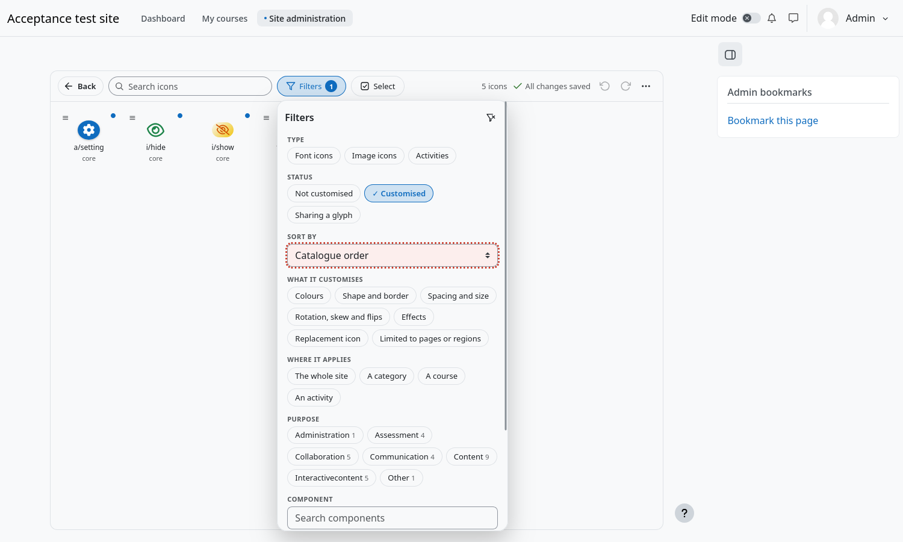
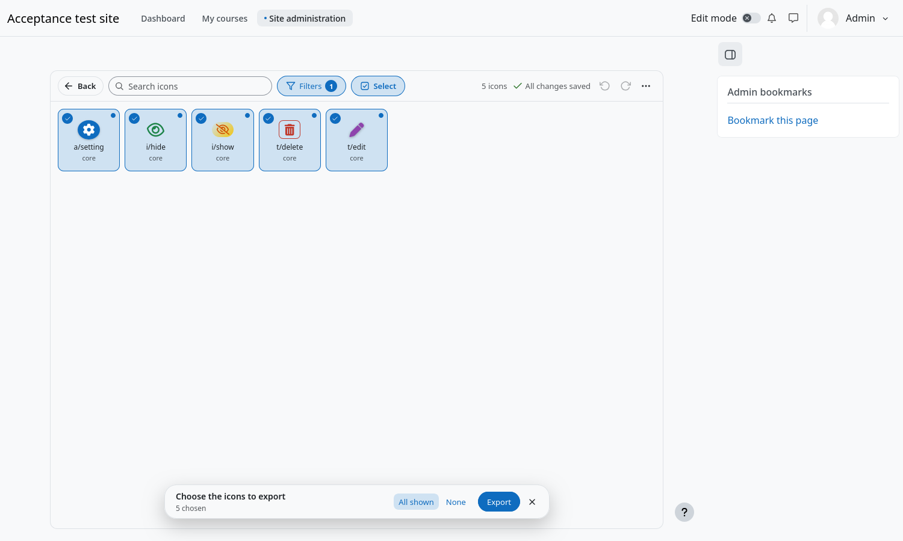

# Finding icons

Moodle has hundreds of icons. The search and the filters get you to the ones you want, and the same narrowing is what *Select*
and *All shown* work on.

## Search

Type in **Search icons**. The search looks at the full name (`core:a/setting`, `mod_forum:monologo`, `activity:assign`) and
needs every word you type.

## Filters

Press **Filters** next to the search. The button shows a round badge with the number of filters that are on, and the panel
opens below it.

| Section | Narrows to |
|---|---|
| **Type** | Font icons, image icons or activities. |
| **Status** | Customised, not customised, or sharing a glyph. |
| **Sort by** | Catalogue order, name, component, or customised first. |
| **What it customises** | Icons that have colours, shape and border, spacing and size, rotation, skew and flips, effects, a replacement icon, or a look limited to some pages or regions. An icon must have all you choose. |
| **Where it applies** | Customisations for the whole site, a category, a course or an activity. |
| **Colour mode** | Customisations for the light or the dark mode (only when your site has colour modes). |
| **Purpose** | The purpose of an activity: assessment, collaboration, communication, content and so on. |
| **Component** | One or several components, with how many icons each has. Type to find one. |

Within a section, choosing several options shows the icons that match **any** of them, except in *What it customises* and
*Status*, where an icon must match **all** of them. The icon in the header of the panel clears every filter at once.

Because the panel only shows a number, many filters never take room away from the icons.

## Choose several icons

Press **Select** in the toolbar. Every customised icon gets a round box:

- Click a card to choose it. **Shift+click** chooses everything between two clicks.
- **All shown** chooses every icon that the search and the filters leave visible. **None** clears the choice.
- Icons that were never customised are dimmed, because there is nothing to export for them.
- Leave with the cross or with **Esc**; nothing changes until you press the action button.

A useful pattern: filter first (for example *Status → Customised* and *Component → mod_forum*), then press **All shown**
and export or copy exactly those icons.
