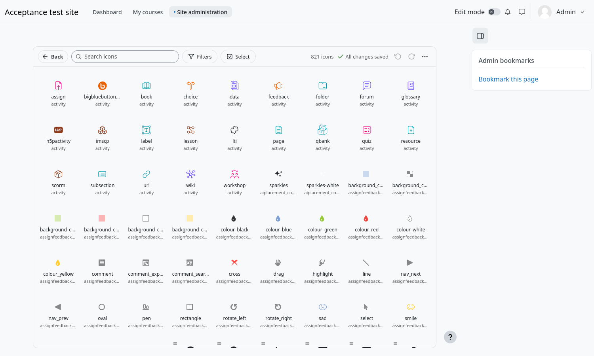
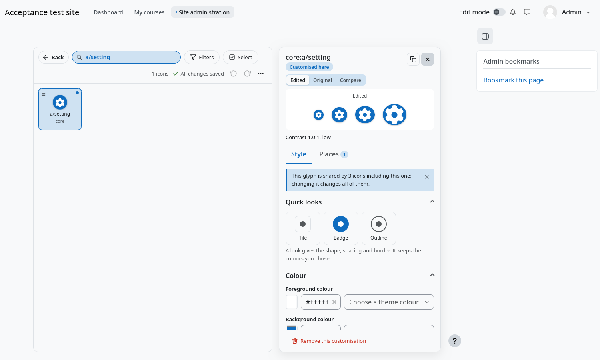

# Getting started

## Open the designer

1. Log in as a manager or administrator.
2. Go to **Site administration → Plugins → Local plugins → Icon Restyle → Icon designer**. The same page is also under
   **Site administration → Appearance → Icon Restyle**.
3. Wait a moment while the catalogue loads. Every icon that can be customised appears as a card.

## Change your first icon

1. Type `a/setting` in the search box. Click the card of the gear.
2. The editing panel opens on the right. Under **Colour**, type `#e83e8c` in the **Foreground colour** box, or click the
   little square to pick one.
3. That is all. The preview on top of the panel shows the new look at four sizes, and a moment later the status next to the
   search says **All changes saved**. Every gear of Moodle now has that colour.

There is no *Save* button. Every change is saved on its own a moment after you make it, and the status always says what is
going on: *Saving…*, *All changes saved* or *Could not save*. **Undo** and **Redo** (Ctrl+Z, Ctrl+Y) are always there, and
they are saved like any other change.

## Go back to how Moodle draws it

Open the icon and press **Remove this customisation** at the bottom of the panel. The icon goes back to what Moodle (and your
theme) draws. Pressing the cross next to a single property puts only that property back.

## Good to know

- A customisation never touches the theme or the files of Moodle. It is a stylesheet that is added to each page.
- Some Moodle icons share the same glyph. Changing one changes all of them, and the panel tells you when that is the case
  (*This glyph is shared by 3 icons*).
- The grid shows what you are editing: the card of the icon you changed always shows its latest look.
