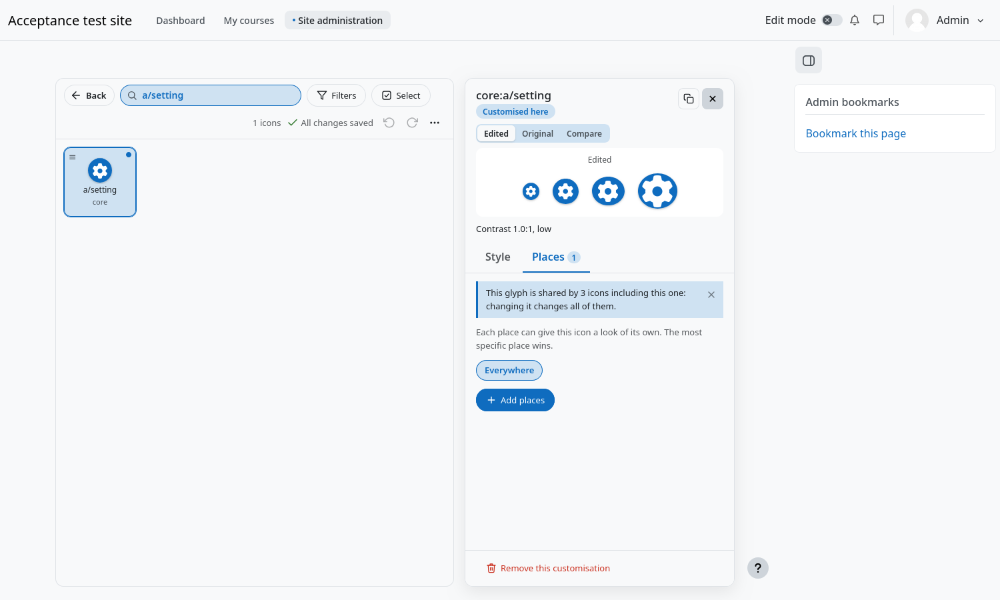
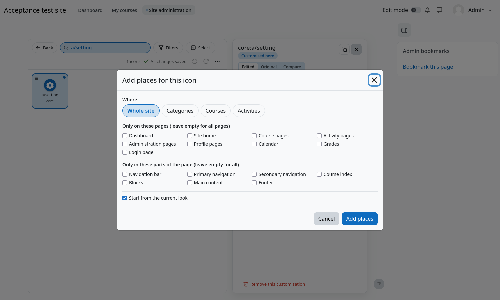
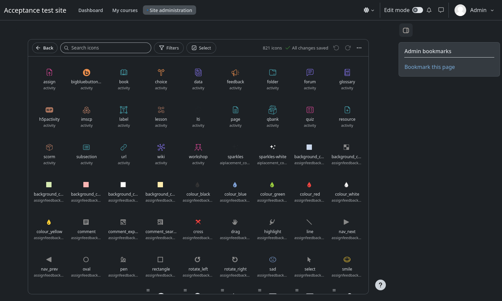

# Places and colour modes

An icon can have a **different look in different places**. The look of the whole site is the starting point and a more
specific place changes it: the most specific one wins.

## The Places tab

Open an icon and press the **Places** tab. Every place where the icon has a look is a chip; **Everywhere** is always there.
Press a chip to edit the look of that place, and the cross on a chip removes it.

## Add places

Press **Add places**. The modal asks:

| Question | Answer |
|---|---|
| **Where** | **Whole site**, **Categories**, **Courses** or **Activities**. For the last three, type a name and choose from the list; you can choose several. A category covers everything inside it, and an activity is looked up by its name inside its course. |
| **Only on these pages** | Activity pages, Administration pages, Calendar, Course pages, Dashboard, Grades, Login page, Profile pages or Site home. Leave empty for every page. |
| **Only in these parts of the page** | Blocks, Main content, Course index, Footer, Navigation bar, Primary navigation or Secondary navigation. Leave empty for every part. |
| **Colour mode** | Only when your site has colour modes: the mode the place belongs to. |
| **Start from the current look** | The new place starts as a copy of the look you are editing, which is usually what you want. |

For example, *Courses → Biology 101* plus *Only in: Navigation bar* gives the icon a look that only shows in the navigation bar
of that course.

## Colour modes

Boost in Moodle 5.3 has colour modes (light, dark and following the device) that a site turns on in the theme settings. Icon
Restyle follows them and uses only what Moodle provides. Earlier Moodle versions have no colour modes, and then nothing about
modes is shown.

- With colour modes **off**, nothing about modes is shown and every look applies everywhere.
- With colour modes **on**, every look belongs to **one** mode. The preview shows the page in the mode it is in, says so
  (*This page is shown in Dark mode, following your device*) and follows it when you change mode.
- Opening an icon opens its look for the mode of the page, which starts from what Moodle draws in that mode.
- The **Light** and **Dark** buttons of the preview change both the background and the look you are editing, so a look is
  never saved for both modes by accident.
- On the **Places** tab, **Copy this look to Dark mode** (or to Light mode) starts the other mode from this one.

To copy the looks of many icons from one mode to another at once, see [Copying looks](Copying-looks.md).
