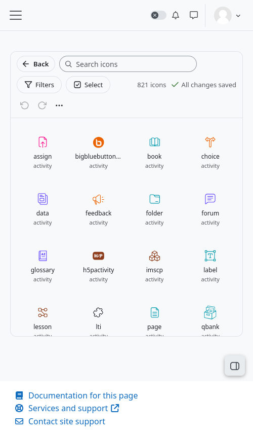

# The designer

The designer is one page with a toolbar, a grid of icons and an editing panel that opens when you click an icon.

## The toolbar

| Control | What it does |
|---|---|
| **Back** | Goes to the page you came from, or to the administration search when there is none. |
| **Search icons** | Narrows the grid as you type. Every word must appear in the name, so `forum mono` finds `mod_forum:monologo`. |
| **Filters** | Opens the filters panel. A round badge says how many filters are on. See [Finding icons](Finding-icons.md). |
| **Select** | Turns the grid into a choice, to export icons or to copy their look. See [Copying looks](Copying-looks.md) and [Export and import](Export-and-import.md). |
| *N icons* | How many icons match the search and the filters. |
| Save status | *All changes saved*, *Saving…* or *Could not save*. Changes are saved on their own. |
| Undo and redo | Ctrl+Z and Ctrl+Y. They also undo what a copy did, in one step. |
| **⋯** menu | Undo, redo, **Export all customisations** and **Import customisations**. |

## The grid

Each card is an icon with its name and the component it belongs to.

- A **blue dot** on a card means the icon has a customisation.
- The **≡** sign on a card means the icon shares its glyph with others.
- The card you have open is outlined. It always shows the latest look you gave it, even before the site has caught up.
- You can move through the cards with the arrow keys and open one with Enter.
- The grid draws only the rows you can see, so a catalogue of thousands of icons opens as fast as a short one.

## The editing panel

Click a card and the panel opens:

1. **Title and origin**: the name of the icon, and whether it is customised here (*Customised here*) or draws as Moodle does (*Moodle default*).
2. **Copy this look to other icons** (the two sheets) and **Close**.
3. **Preview**: *Edited*, *Original* or *Compare*, on a light or a dark background.
4. **Tabs**: **Style** and **Places**.
5. **Remove this customisation** at the bottom.

See [Editing an icon](Editing-an-icon.md) and [Places and colour modes](Places-and-colour-modes.md).

## On a small screen

The designer follows Moodle's own responsive layout. On a phone the grid goes first and the editing panel appears below it,
the toolbar wraps to several rows, and the filters panel uses the whole width.

## Light and dark

The designer uses the colours of the active theme and follows Moodle's colour modes. If your site has them turned on, the
preview shows the page in the mode it is in and follows it when you change it.

